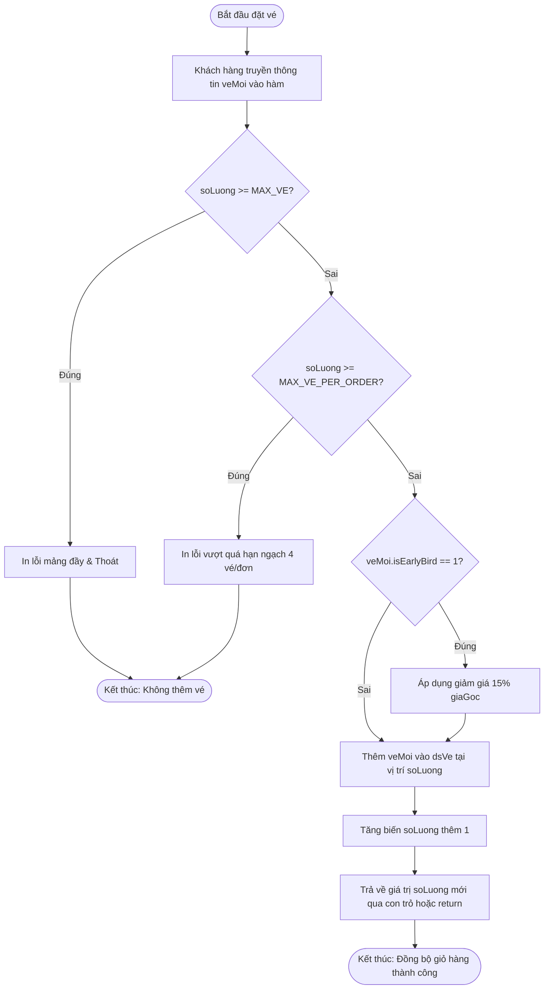

# BÁO CÁO PHÂN TÍCH LỖI TRUYỀN THAM TRỊ (PASS-BY-VALUE) VÀ GIẢI PHÁP KHẮC PHỤC HỆ THỐNG ĐẶT VÉ TICKETBOX

> 👤 **Học viên:** Hoàng Công Dũng | **Mã SV:** PTIT-HCM-009
> 🏫 **Môn học:** it102-rl-hoangcongdung

---

## 📊 Sơ đồ thiết kế hệ thống (Activity Diagram)

> 💡 *Sơ đồ dưới đây được render tự động trực tiếp trên GitHub bằng Mermaid. Bạn cũng có thể tải file **`bt1.drawio`** trong repository này để mở và chỉnh sửa trực tiếp trên [Draw.io (diagrams.net)](https://app.diagrams.net).* 

---

## Nhiệm vụ 1: Phân tích lỗi & Lập bảng Test Cases

Sau khi thực hiện đọc hiểu mã nguồn hiện tại của hệ thống Ticketbox, chúng ta phát hiện hai nguyên nhân kỹ thuật cốt lõi gây ra lỗi nghiệp vụ:

Thứ nhất, sự cố biến đếm soLuong trong main() luôn bằng 0 xuất phát từ cơ chế truyền tham trị (pass-by-value) của ngôn ngữ C. Khi gọi hàm datVeConcert(dsVe, soLuong, ve1), giá trị của biến soLuong từ hàm main() được copy vào tham số soLuong của hàm. Mọi thao tác tăng giá trị soLuong++ bên trong hàm chỉ tác động lên biến cục bộ bản sao và bị hủy bỏ khi hàm kết thúc. Biến soLuong gốc trong main() hoàn toàn không được cập nhật.

Thứ hai, hệ thống thiếu hoàn toàn cơ chế kiểm tra hạn ngạch mua vé tối đa trong một giao dịch (MAX_VE_PER_ORDER = 4 vé). Đoạn code ban đầu chỉ kiểm tra dung lượng tổng của mảng MAX_VE mà bỏ quên ràng buộc nghiệp vụ về số lượng vé tối đa cho phép trên mỗi đơn hàng.

- Nguyên nhân 1: Truyền tham trị khiến thay đổi giá trị cục bộ không phản ánh ra bên ngoài hàm main().
- Nguyên nhân 2: Thiếu khối điều kiện kiểm tra ràng buộc số lượng vé tối đa trong một lần giao dịch.
- Giải pháp khắc phục: Thay đổi kiểu trả về của hàm đặt vé thành kiểu int để trả về số lượng vé mới, hoặc sử dụng con trỏ (pass-by-reference) để cập nhật trực tiếp địa chỉ biến.

| Trường hợp kiểm thử | Dữ liệu đầu vào | Kết quả sai thực tế | Kết quả đúng mong đợi |
| --- | --- | --- | --- |
| TC01: Kiểm tra đồng bộ số lượng vé | Đặt 2 vé (Mã 101 và 102) từ main() | In ra thông báo 'Hiện chưa có vé nào được đặt' và soLuong = 0 | Hiển thị danh sách 2 vé đã đặt thành công và soLuong = 2 |
| TC02: Kiểm tra hạn ngạch đặt vé | Khách hàng đặt liên tiếp 6 vé trong một phiên | Hệ thống chấp nhận tất cả 6 vé mà không có cảnh báo | Từ chối từ vé thứ 5 trở đi và thông báo vi phạm hạn ngạch tối đa 4 vé |

## Nhiệm vụ 2: Sửa lỗi mã nguồn (main.c)

Dưới đây là mã nguồn đã được chỉnh sửa toàn diện trong tệp main.c. Chương trình được bổ sung cơ chế trả về số lượng vé mới từ hàm datVeConcert để đồng bộ trực tiếp với biến soLuong trong khối lệnh main(), đồng thời thêm ràng buộc kiểm tra giới hạn số lượng vé tối đa trong một đơn hàng.

- Áp dụng kiểu trả về int cho hàm datVeConcert để cập nhật số lượng vé.
- Bổ sung điều kiện kiểm tra số lượng vé trong đơn hàng không vượt quá MAX_VE_PER_ORDER.
- Tuân thủ nghiêm ngặt phạm vi kiến thức lập trình C cơ bản, không sử dụng các cấu trúc dữ liệu quá phức tạp.

---

## 📁 Danh sách tệp tin nộp bài trong Repository
- 📝 `bt1.docx`: Báo cáo tài liệu phân tích nghiệp vụ hoàn chỉnh.
- 🎨 `bt1.drawio`: File thiết kế sơ đồ chuẩn theo quy định đề bài (mở trực tiếp bằng [Draw.io](https://app.diagrams.net) hoặc Lucidchart).
- 💻 `main.c`: Mã nguồn chương trình.
